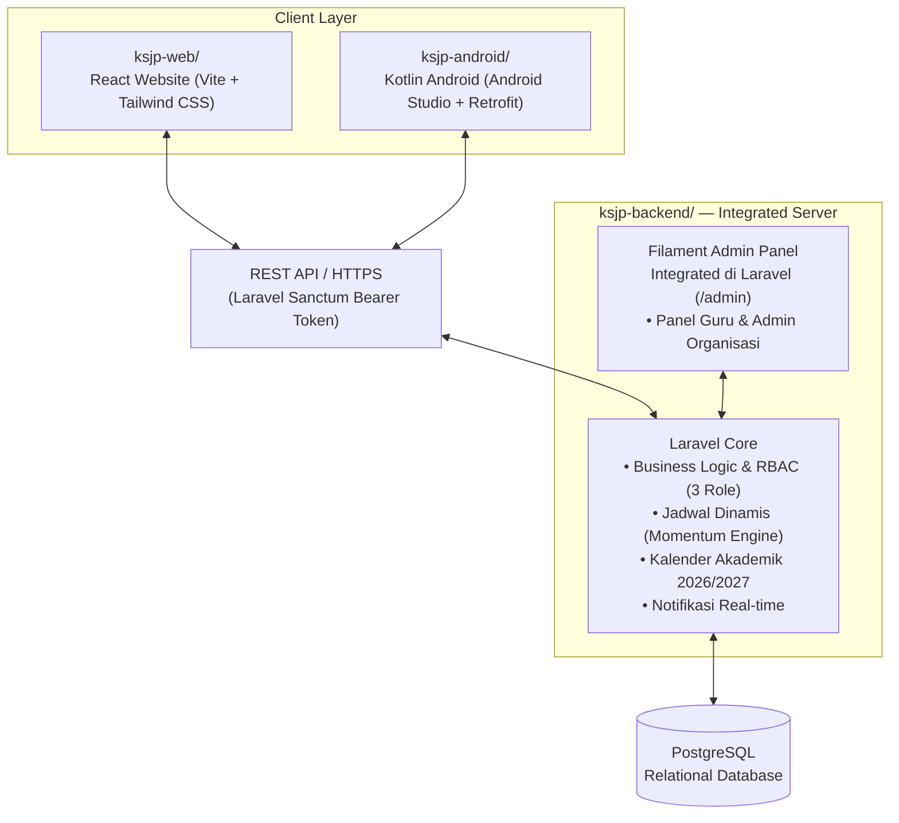

# BLUEPRINT — KSJP (Kalender Siswa & Jadwal Pelajaran)

**Instansi:** SMK Telkom Purwokerto  
**Tahun Pelajaran:** 2026/2027  
**Referensi Desain UI (Google Stitch):** https://stitch.google.com/projects/9503416919859142393  

---

## 1. Visi & Ringkasan Proyek

**KSJP (Kalender Siswa & Jadwal Pelajaran)** adalah ekosistem terintegrasi berbasis REST API untuk menyampaikan jadwal pelajaran harian, perubahan jadwal mendadak (**Jadwal Dinamis / Momentum**), agenda kalender pendidikan resmi SMK Telkom Purwokerto Tahun Pelajaran 2026/2027, serta notifikasi real-time kepada siswa melalui **Website (React)** dan **Aplikasi Mobile (Kotlin Android)** dengan pusat kendali admin berbasis **Laravel + Filament Admin** dan basis data **PostgreSQL**.

---

## 2. Arsitektur Sistem

Mengacu pada arsitektur sistem KSJP:



---

## 3. Struktur Direktori Proyek

Seluruh kode proyek dipisahkan secara modular di dalam root `d:\KSJP\`:

```text
KSJP/
├── BLUEPRINT.md          # Dokumentasi arsitektur tetap proyek KSJP
├── API_CONTRACT.md       # Spesifikasi & contoh JSON kontrak REST API
├── ksjp-backend/         # Tahap 1: Laravel + Filament Admin + Sanctum + PostgreSQL
├── ksjp-web/             # Tahap 2: React Website (Vite + Tailwind CSS)
└── ksjp-android/         # Tahap 3: Kotlin Android (Android Studio + Retrofit)
```

---

## 4. Aturan Peran (Role-Based Access Control)

Sistem KSJP **HANYA memiliki 3 peran** (tanpa peran Kepala Sekolah dan tanpa peran Admin Kurikulum; seluruh pengelolaan jadwal dipegang oleh `guru`):

| Role (`users.role`) | Akses Platform | Tanggung Jawab & Hak Akses |
|---|---|---|
| `siswa` | React Web & Kotlin Android (REST API) | Login 1x persisten menggunakan NIS/Username, melihat jadwal pelajaran reguler & momentum kelasnya, melihat kalender pendidikan 2026/2027 (termasuk agenda organisasi), serta menerima notifikasi real-time pergantian jam & jadwal momentum. Tidak memiliki akses ke `/admin`. |
| `guru` | Filament Admin (`/admin`) + API | Mengelola jadwal pelajaran reguler (`jadwal_pelajaran`), menginput/mengelola Jadwal Dinamis (`jadwal_momentum`) pada tanggal tertentu (penggantian guru, perubahan ruangan, pergantian mapel, atau jam kosong/tugas), serta mengelola data kelas jika diperlukan. |
| `admin_organisasi` | Filament Admin (`/admin`) + API | Perwakilan organisasi siswa (OSIS, MPK, PMR, Pramuka) untuk menambahkan dan mengelola agenda kegiatan siswa pada `kalender_akademik` serta memicu notifikasi kegiatan. |

---

## 5. Desain Skema Database (PostgreSQL)

### 5.1 Tabel `kelas`
- `id` (PK)
- `nama_kelas` (misal: `XI PPLG 4`)
- `tingkat` (misal: `XI`)
- `konsentrasi` (misal: `Rekayasa Perangkat Lunak`)
- `wali_kelas` (misal: `Firda Ayu Nirmala, S.Kom`)
- `tahun_ajaran` (misal: `2026/2027`)
- `timestamps`

### 5.2 Tabel `users`
- `id` (PK)
- `nis` (string, unique, nullable untuk akun non-siswa; NIS asli untuk siswa / NIP/kode login untuk guru & admin organisasi)
- `username` (string, unique — mendukung login menggunakan NIS atau Username)
- `nama_lengkap` (string)
- `email` (string, unique, nullable)
- `role` (enum/string: `siswa`, `guru`, `admin_organisasi`)
- `id_kelas` (FK -> `kelas.id`, nullable untuk `guru` / `admin_organisasi`)
- `jenis_kelamin` (enum/string: `L`, `P`, nullable)
- `jabatan_organisasi` (string, nullable — misal `OSIS`, `MPK`, `PMR`, `Pramuka`, atau mapel ampu guru)
- `password` (hashed)
- `remember_token`, `timestamps`

### 5.3 Tabel `jadwal_pelajaran` (Jadwal Reguler Mingguan)
- `id` (PK)
- `id_kelas` (FK -> `kelas.id`)
- `id_guru` (FK -> `users.id`, nullable)
- `hari` (enum/string: `Senin`, `Selasa`, `Rabu`, `Kamis`, `Jumat`, `Sabtu`)
- `jam_ke` (integer, urutan jam pelajaran 1..N)
- `jam_mulai` (time, format `HH:MM:SS`)
- `jam_selesai` (time, format `HH:MM:SS`)
- `mata_pelajaran` (string)
- `nama_guru` (string)
- `ruangan` (string)
- `timestamps`

### 5.4 Tabel `jadwal_momentum` (Jadwal Dinamis Override)
- `id` (PK)
- `id_kelas` (FK -> `kelas.id`)
- `id_jadwal_reguler` (FK -> `jadwal_pelajaran.id`, nullable — jika menimpa slot jam pelajaran reguler tertentu)
- `tanggal` (date, format `YYYY-MM-DD`)
- `jam_ke` (integer, nullable — dipakai bila tidak merujuk `id_jadwal_reguler` atau untuk slot tambahan)
- `jam_mulai` (time, nullable)
- `jam_selesai` (time, nullable)
- `mata_pelajaran` (string, nullable — nilai pengganti; fallback ke jadwal reguler bila null)
- `nama_guru_pengganti` (string, nullable)
- `ruangan_baru` (string, nullable)
- `status_perubahan` (string: `penggantian_guru`, `pindah_ruangan`, `ganti_mapel`, `jam_kosong`, `kegiatan_khusus`, `jadwal_tambahan`)
- `keterangan` (text, nullable)
- `dibuat_oleh` (FK -> `users.id`, guru pembuat momentum)
- `timestamps`

### 5.5 Tabel `kalender_akademik` (Kalender Resmi 2026/2027 + Agenda Organisasi)
- `id` (PK)
- `judul` (string)
- `tanggal_mulai` (date)
- `tanggal_selesai` (date)
- `kategori` (string: `libur_tahun_pelajaran`, `masuk_sekolah`, `upacara`, `libur_umum`, `libur_semester`, `ramadhan_idul_fitri`, `pkl`, `ujian_asesmen`, `kelulusan`, `penyerahan_lhb`, `ukk`, `hut_sekolah`, `agenda_organisasi`, `kegiatan_sekolah`)
- `sumber` (string: `resmi_sekolah` | `organisasi`)
- `penyelenggara` (string, nullable — misal `SMK Telkom Purwokerto`, `OSIS`, `MPK`, `PMR`, `Pramuka`)
- `target_kelas` (string, nullable — misal `Semua Kelas`, `Kelas X`, `Kelas XI`, `Kelas XII`, `XI PPLG 4`)
- `is_libur` (boolean, default `false`)
- `deskripsi` (text, nullable)
- `dibuat_oleh` (FK -> `users.id`, nullable)
- `timestamps`

### 5.6 Tabel `notifikasi`
- `id` (PK)
- `id_user` (FK -> `users.id`, nullable — null berarti broadcast kelas/global)
- `id_kelas` (FK -> `kelas.id`, nullable)
- `judul` (string)
- `pesan` (text)
- `tipe` (string: `momentum`, `pergantian_jam`, `kalender`, `pengumuman`)
- `data_payload` (jsonb/json, nullable — metadata seperti `tanggal`, `id_jadwal_momentum`, `id_kalender`)
- `is_read` (boolean, default `false`)
- `read_at` (timestamp, nullable)
- `timestamps`

---

## 6. Business Logic Wajib

### 6.1 Jadwal Dinamis (Momentum)
1. Saat klien memanggil `GET /api/jadwal` (dengan parameter opsional `tanggal`, default hari ini, atau rentang/mingguan):
   - Sistem menentukan kelas target (dari user `siswa` yang login, atau query parameter `id_kelas` bagi `guru`/`admin_organisasi`).
   - Sistem mengambil jadwal reguler dari `jadwal_pelajaran` sesuai nama hari dari `tanggal` tersebut.
   - Sistem mengecek tabel `jadwal_momentum` pada `id_kelas` dan `tanggal` yang sama.
   - Setiap entri `jadwal_momentum` yang cocok (`id_jadwal_reguler` atau `jam_ke`) **otomatis menimpa** field `mata_pelajaran`, `nama_guru`, `ruangan`, `jam_mulai`, `jam_selesai` pada slot tersebut, menambahkan informasi `status_perubahan` & `keterangan`, serta menyertakan flag `"is_momentum": true`.
   - Jika terdapat `jadwal_momentum` baru yang tidak terikat ke slot reguler (`jadwal_tambahan`), entri tersebut tetap disisipkan ke daftar jadwal hari itu dengan `"is_momentum": true` dan diurutkan berdasarkan `jam_mulai`/`jam_ke`.
   - Slot jadwal reguler yang tidak memiliki momentum dikembalikan dengan `"is_momentum": false`.

### 6.2 Notifikasi Real-time
1. **Trigger Jadwal Momentum:** Setiap kali `guru` menyimpan data baru atau memperbarui `jadwal_momentum` (melalui Filament Admin atau Observer Eloquent), sistem otomatis membuat record di tabel `notifikasi` dengan tipe `momentum` untuk kelas terdampak (sehingga langsung muncul di `GET /api/notifikasi` dan siap di-push via WebSocket/SSE/FCM pada integrasi frontend).
2. **Trigger Agenda Organisasi / Kalender:** Ketika `admin_organisasi` menambahkan agenda baru di `kalender_akademik`, sistem membuat notifikasi bertipe `kalender`.
3. **Pengingat Pergantian Jam Pelajaran:** Backend menyediakan metadata slot jam pelajaran (`jam_mulai`, `jam_selesai`, `slot_aktif`, `slot_berikutnya`, `sisa_menit`) serta endpoint/command pengingat pergantian jam (`notifikasi:check-bell` / endpoint `GET /api/notifikasi` yang menyertakan status pergantian jam aktif) agar React Web dan Kotlin Android dapat menampilkan pengingat real-time secara presisi.

---

## 7. Data Acuan Resmi yang Ditanamkan (Seeder)

- **Kelas XI PPLG 4** (`Konsentrasi: Rekayasa Perangkat Lunak`, `Wali Kelas: Firda Ayu Nirmala, S.Kom`) beserta **29 siswa asli** lengkap dengan NIS (`541251004` s.d. `541251302`), nama lengkap, dan jenis kelamin (`20 L`, `9 P`).
- **Akun Contoh Peran Non-Siswa:** akun `guru` (termasuk Wali Kelas `Firda Ayu Nirmala, S.Kom`) dan akun `admin_organisasi` (OSIS/MPK/PMR/Pramuka).
- **Kalender Pendidikan SMK Telkom Purwokerto TP 2026/2027** (Juli 2026 – Juni 2027, ditetapkan di Purwokerto 10 Juli 2026 oleh Kepala Sekolah Aris Puji Santoso, S.Kom.M.M.) beserta seluruh tanggal penting dan hari libur resmi.

---

## 8. Tahapan Implementasi

- **Tahap 1 (Fokus Saat Ini):** Dokumentasi (`BLUEPRINT.md`, `API_CONTRACT.md`) & Backend (`ksjp-backend/`: Laravel, Filament Admin, PostgreSQL schema, Seeder data asli, Sanctum REST API, dan pengujian otomatis).
- **Tahap 2:** Frontend Website (`ksjp-web/`: React + Vite + Tailwind CSS mengikuti desain Google Stitch).
- **Tahap 3:** Aplikasi Android (`ksjp-android/`: Kotlin + Retrofit mengikuti desain Google Stitch).
